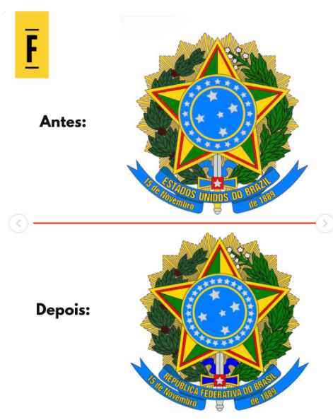

Primeiro vamos rir: Willer Tomáz, a ratazana amiga de Flávio que lavou mais de 5 bilhões em bet e está foragido, [pediu pra justiça impedir o MST de invadir sua propriedade roubada de Richarlison](https://www.metropoles.com/colunas/demetrio-vecchioli/apos-deixar-o-pais-willer-pede-que-justica-proiba-mst-de-ocupar-mansao).

Agora, ao assunto: acontece que Flávio ainda NÃO TINHA CHEGADO aos EUA ontem!

[A imprensa corporativa inteira deu barrigada](https://oglobo.globo.com/blogs/miriam-leitao/post/2026/10/operacao-despiste-de-flavio-bolsonaro-deu-certo-ele-ficou-no-brasil-ate-as-22h50-de-ontem.ghtml) e soubemos, na madrugada de terça para quarta, que ele esteve aguardando papelada no Paraguai pra só então se encaminhar pra Argentina, em Puerto Iguazú, e fugir no jatinho privado.

Tudo armado pelo Marco Rubio em parceria com Javier Milei.

## Enquanto isso...

* A lua de mel continua!
  
* Também vimos que o governo [começou a articular um "blocão" na Câmara para isolar o PL](https://bsky.app/profile/alansight.bsky.social/post/3mywljy4i7k2f). Vamos ver até onde isso dá certo.
* PSOL conseguiu atingir a [cláusula de barreira via uma regra de arredondamento](https://g1.globo.com/politica/noticia/2026/10/28/tse-decide-que-federacao-psol-rede-cumpriu-clausula-de-barreira.ghtml) aprovada por unanimidade no TSE e prevista na ABNT, olha só!
* [Um agradecimento/parabenização muito fofo de meninas em Gaza a Lula](https://bsky.app/profile/proftoni.bsky.social/post/3mywmm7ffnc2z)
* Crianças engajando politicamente de brincadeira deram vitória a Lula também no Roblox hahaha
  

## E aí chegou a carta do golpe

O que aconteceu foi que Flávio, assim que desembarcou nos EUA, [lançou uma carta](https://oglobo.globo.com/politica/eleicoes-2026/noticia/2026/10/29/imprensa-internacional-repercute-carta-de-flavio-bolsonaro-com-teor-golpista.ghtml) dizendo que não reconheceria o resultado das eleições e que ele era o de fato Presidente eleito do Brasil. Coitado, em surto.

O interessante da carta é que ele usou esse palavrado chulo e um brasão antigo do Brasil onde lia-se "Estados Unidos do Brazil". Se foi erro, se foi burrice alimentada por ChatGPT, má fé para irritar oponentes ou qualquer outra maluquice, só o terapeuta inexistente dele saberia.

[Trump não curtiu e disse que não ia comentar.](https://www.bbc.com/portuguese/articles/c6ewe74wkzdqo)

Até porque Lula pediu pra ele não tomar partido, e [ele ACATOU](https://g1.globo.com/mundo/noticia/2026/10/29/trump-diz-que-falara-com-lula-e-volta-a-criticar-eleicoes.ghtml).

Eles demoraram a reconhecer a vitória de Lula, mas no fim se entregaram.

[Outros aliados também soltaram a mão rapidinho assim que a intenção golpista floreceu.](https://www1.folha.uol.com.br/poder/2026/10/tarcisio-diz-entender-sentimento-de-flavio-mas-que-eleicao-acabou-e-urnas-devem-ser-respeitadas.shtml)