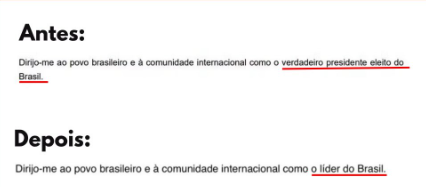

Daqui pra frente vamos em modo de lista pelo bem da brevidade.

* [A galera do assédio eleitoral começou a tomar processo de denúncias feitas ao ministério público do trabalho](https://oglobo.globo.com/economia/noticia/2026/10/29/demissao-por-voto-em-3-dias-mais-de-mil-empresas-sao-denunciadas-por-assedio-eleitoral.ghtml)
* [Conversas fortes de que Érika Hilton virá para o PT](https://www1.folha.uol.com.br/colunas/painel/2026/10/erika-hilton-deixara-o-psol-e-migrara-para-o-pt-em-janeiro-afirmam-correligionarios.shtml)
* [Talvez também Boulos e Janones](https://www.cnnbrasil.com.br/politica/pt-articula-migracao-de-janones-erika-hilton-e-boulos-apos-eleicao/)
* Aliados do Flávio tentam lavar a mão mas o sangue seco não sai
  
* [Pastor Marcio Poncio se fudeu na nova fase da operação Unha e Carne](https://noticias.uol.com.br/cotidiano/ultimas-noticias/2026/10/29/pf-faz-9-fase-da-operacao-unha-e-carne-e-cumpre-mandados-no-rio.ghtm) (já estava preso)
* [Paulo Guedes investigado por crime financeiro](https://www.metropoles.com/colunas/tacio-lorran/pf-investiga-paulo-guedes-por-crime-contra-o-sistema-financeiro)
* [Netanyahu toma no cu nas eleições para o Knesset e grita FRAUDE](https://operamundi.uol.com.br/israel/apos-perder-maioria-no-parlamento-netanyahu-contesta-eleicoes-em-israel-e-acusa-fraude/) (claro)
* [O CEO da nVidia estava de romance com uma espiã chinesa que estava repassando todos os segredos pra Pequim](https://www.nytimes.com/2026/10/29/us/politics/nvidia-china-jensen-huang-trump.html)
* [Coletânea de aliados do Flávio muito brabos com a verborragia golpista dele](https://oglobo.globo.com/politica/noticia/2026/10/29/desabafo-eleicao-acabou-jumentos-do-tse-a-malafaia-e-aliados-todas-as-reacoes-a-carta-golpista-de-flavio.ghtml)
* [Bolha de IA ESPRUDEU na Coréia do Sul](https://veja.abril.com.br/economia/euforia-da-ia-da-lugar-ao-panico-e-bolsa-da-coreia-do-sul-despenca-40/) (como diria Janones, explooooode!)
* [Segue pressão por impeachment de Ricardo Nunes e a história da retenção dos ônibus na eleição](https://jornalggn.com.br/cidades/comissao-avalia-impeachment-de-ricardo-nunes-por-suspeita-de-uso-da-maquina-no-2o-turno/)
* [Lula e Janones de conversinha](https://revistaforum.com.br/politica/lula-convoca-janones) (ia ter uma live dos dois hoje mas estão ambos sem voz, ficou pra próxima semana)
* [Embaixada dos EUA finalmente CRAVOU vitória "definitiva" e "surpreendente" de Lula](https://www1.folha.uol.com.br/poder/2026/10/embaixada-dos-eua-em-brasilia-destacou-em-relatorio-vitoria-definitiva-de-lula.shtml)
* [Descobriram uma carreata de comemoração do COMANDO VERMELHO pela vitória do Flávio em São Gonçalo RJ](https://agenciasportlight.com.br/index.php/2026/10/28/inteligencia-da-policia-militar-atribui-ao-comando-vermelho-evento-para-comemorar-vitoria-de-flavio-bolsonaro/)
* [TSE define que violência contra mulher torna candidato inelegível](https://www.cnnbrasil.com.br/politica/tse-decide-que-agressao-contra-a-mulher-pode-tornar-candidato-inelegivel/) (claro, depois do PL levar 28 cadeiras do Senado)
* [Érika Hilton começou a recolher assinaturas para a CPI das Big Techs](https://iclnoticias.com.br/erika-hilton-protocola-cpi-big-techs-eleicoes/)
* **BONUS ROUND:** [pequena burguesia chora sangue porque apostou na vitória de Flávio e perdeu](https://www.estadao.com.br/economia/pessoas-fisicas-perdas-investimentos-aposta-vitoria-flavio/) (NÃO GOSTAVA DE BET?)